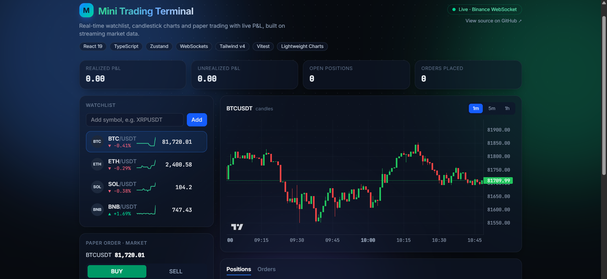

# Mini Trading Terminal

A real-time trading terminal built with React and TypeScript. It streams live market data over WebSockets and lets you track a watchlist, view candlestick charts, and practice with paper trades that show live profit and loss.

**[Live demo](https://YOUR-VERCEL-URL.vercel.app)** | **[Source code](https://github.com/chetanmeshram10/Mini-Trading-Terminal-App)**



---

## Overview

This project is a small slice of a real trading front end. It focuses on the problems that matter in live-data interfaces: handling high-frequency updates without UI lag, recovering from dropped connections, and keeping financial calculations correct and tested.

Market data comes from Binance's public WebSocket and REST endpoints. No API key is required, and no real money is involved. All trading is simulated.

## Features

- **Live watchlist** with real-time prices, 24h change, price-flash on every tick, and inline sparklines
- **Add and remove symbols** at runtime, with dynamic WebSocket subscribe and unsubscribe
- **Candlestick charts** with 1m, 5m and 1h timeframes, loaded from REST history and updated live over WebSocket
- **Paper trading** with market orders, buy/sell toggle, quick quantity presets and estimated order value
- **Positions and orders** tables with live unrealized P&L, realized P&L, and short-selling support
- **Scrolling ticker tape** and animated summary stats
- **Persistent state**: watchlist, positions and order history survive page refreshes
- **Connection status indicator** showing live, connecting, reconnecting or demo state
- **Responsive layout** that works on desktop and mobile
- **Reduced-motion support** for users who disable animations at the OS level

## Tech stack

| Area | Tools |
| --- | --- |
| UI | React 19, TypeScript, Vite |
| State | Zustand (with persist middleware) |
| Styling | Tailwind CSS v4, custom CSS animations |
| Charts | TradingView Lightweight Charts |
| Data | Binance public WebSocket and REST APIs |
| Testing | Vitest |
| Deployment | Vercel |

## Engineering decisions

**Tick batching.** Exchange messages can arrive many times per second. Incoming ticks are buffered and flushed to the store every 250 ms in a single update, so React renders at a steady pace instead of once per message.

**Granular subscriptions.** Each watchlist row selects only its own price slice from the store and is wrapped in `React.memo`. A BTC update does not re-render the ETH row.

**Resilient WebSocket client.** The feed reconnects with exponential backoff (1s up to 15s), rotates between endpoints, and automatically re-subscribes to all symbols after a reconnect.

**Graceful fallback.** If the exchange is unreachable, the app switches to clearly labelled simulated prices so the interface never appears broken. It returns to live data as soon as a connection succeeds.

**Pure, tested trading logic.** Position math lives in a side-effect-free module (`src/lib/trading.ts`). It handles weighted-average entry prices, partial closes, full closes and long-to-short flips, and is covered by unit tests.

**Animation performance.** Animations use only `transform` and `opacity` so they stay on the GPU, and they are disabled when `prefers-reduced-motion` is set.

## Getting started

### Prerequisites

- Node.js 20 or newer
- npm

### Installation

```bash
git clone https://github.com/chetanmeshram10/Mini-Trading-Terminal-App.git
cd Mini-Trading-Terminal-App
npm install
```

### Run locally

```bash
npm run dev
```

Open `http://localhost:5173` in your browser.

### Other scripts

```bash
npm test         # run unit tests
npm run build    # type-check and create a production build
npm run preview  # preview the production build
npm run lint     # run ESLint
```

## Project structure

```
src/
  components/
    Chart.tsx          Candlestick chart with timeframe switcher
    OrderForm.tsx      Paper order entry
    Positions.tsx      Positions and order history tables
    Stats.tsx          Animated P&L summary cards
    TickerTape.tsx     Scrolling price ticker
    Watchlist.tsx      Live watchlist with sparklines
  hooks/
    useAnimatedNumber.ts
  lib/
    priceFeed.ts       WebSocket client: reconnect, batching, fallback
    trading.ts         Pure position and P&L logic
    trading.test.ts    Unit tests
    motion.ts          Animation helpers
  store/
    useTerminal.ts     Zustand store (prices, positions, orders)
  types.ts
  App.tsx
```

## Testing

The trading engine is covered by Vitest unit tests for:

- Opening a position
- Averaging the entry price when adding to a position
- Realizing P&L on a partial close
- Closing a position fully
- Flipping from long to short

```bash
npm test
```

## Roadmap

- Limit and stop orders
- Order book depth view
- Option chain viewer
- Component tests with React Testing Library
- Candle indicators (SMA, EMA)

## Disclaimer

This is a learning project. It uses simulated trading only and is not financial advice.

---

<div align="center">

**⭐ If you find this project interesting, consider starring the repo!**

Built by [Chetan Meshram](https://github.com/chetanmeshram10)

</div>
